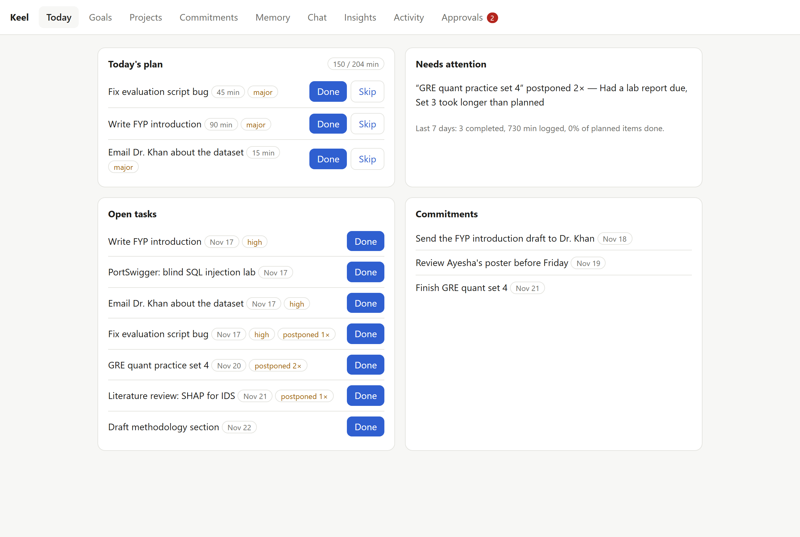
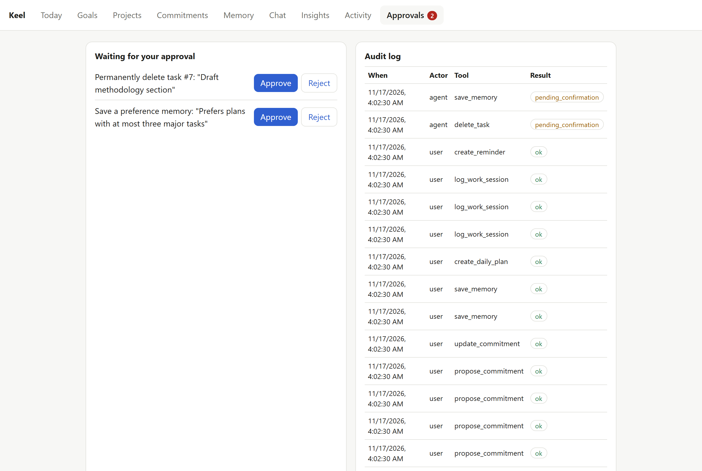
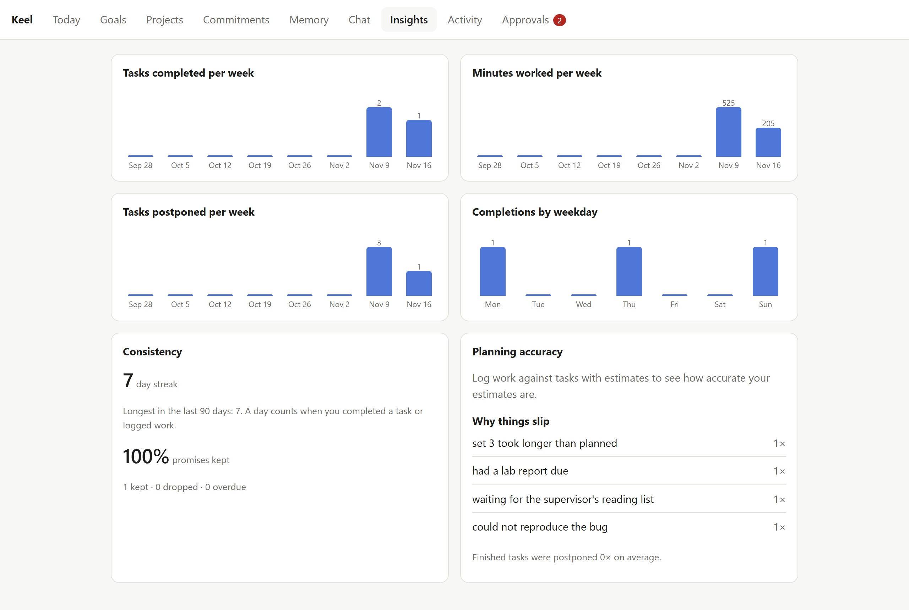

# Keel

**A self-hosted personal AI agent that remembers your commitments, plans realistic days, tracks what actually gets done, and follows up.**

Most assistants forget what you said yesterday and happily agree that you'll "start tomorrow". Keel keeps the books:
what you promised, what you planned, what slipped (and the reason you gave), and what you actually worked on. It uses
that record to plan days that fit, to ask *why* something keeps slipping, and to check in with you. It runs on your
machine, with your data in one SQLite file.

> **The LLM decides and talks. Code stores, computes and enforces.** Deadlines, counts, plans, permissions, notification
> limits and security checks are code with tests, not promises in a prompt.

## What it does

| | |
|---|---|
| **Personal setup** | On first start the dashboard asks your name and how to address you, your time zone and working hours, main goals and responsibilities, preferences, and when check-ins should come. Every question can be skipped, and the **Profile** button changes the answers later. Answers become memories and goals you can see; time zone and hours apply at once, without editing `.env`. |
| **Capture inbox** | One box for anything ("renew my passport", "remind me at 6pm to call the bank", "remember my CGPA is 3.6", a link to read later). Keel suggests a task, reminder, memory, note or project update from your words, says why, and lets you change the type or any field. Nothing is saved until you file it. The suggestions come from plain rules, so there's no model call and nothing leaves your computer. |
| **Chat** | Talk to it in the web dashboard or the terminal. It calls tools to read and change your data. Reminders and check-ins arrive by email. |
| **Gmail** | Search and read your mail, summarize a thread, sort the inbox into deadlines, needs-a-reply, applications and newsletters, and pull out dates and action items. Keel drafts replies and follow-ups into your Gmail Drafts; it sends only after you approve the exact recipients, subject, text and attachments (with a warning for an address you've never written to), at most 20 a day. Attachments can be saved into your notes folder to search later. Emails are treated as untrusted text, so instructions inside one can't make Keel act. You connect your own Google account once; Keel can't delete mail or change labels. |
| **Google Calendar** | With the same Google sign-in, Keel lists your events and adds, moves, edits or deletes them, and can put a day's planned time blocks into your calendar (never twice). Every change waits for your approval of the exact change, with a warning when it overlaps another event (shown by time only), when the event has guests, or when it repeats. It is checked again when you approve, so an event edited in the meantime is left alone. Guests are never emailed, and Keel can't touch calendar settings or sharing. Off until you set `GOOGLE_CALENDAR_ENABLED=true`. |
| **Keel's browser** | Its own Chromium (never your browser) opens sites, reads them, clicks links and tabs, fills forms, attaches your documents and downloads files into your notes. It stops before anything consequential: a click that would submit, pay, delete, sign in or register is refused, and typing into a page, attaching a file or submitting always waits for your approval of the exact site, values and button (checked again when you approve). It never types passwords, payment details, one-time codes or ID numbers, and leaves CAPTCHAs to you. Off until `BROWSER_ENABLED=true`. |
| **Voice** | In the dashboard's chat, press the microphone and speak (English or Urdu): your words fill the message box and you press Send, so a misheard word never runs a command. Replies can be read aloud, by switching on "Read replies aloud" or with the Read aloud button on any reply. It uses your browser's own speech features, so there is no extra key or service to set up. Dictation works in Chrome, Edge and Safari; in Chrome and Edge the audio goes to the browser's own speech service (Google or Microsoft). Read-aloud works in every current browser. |
| **Projects** | A progress report built from the database (tasks done, overdue and waiting, time worked), a log of updates, blockers and decisions with their reasons, attached notes and links, and the project's GitHub pull requests. A blocker still open after 3 and 7 days gets a nudge. Mentioning a project by name ("my FYP is stuck") is enough. |
| **Goals → milestones → tasks** | "I want to get good at web pentesting" becomes a goal, ordered milestones, and concrete first tasks. |
| **Commitments** | Notices "I'll finish the GRE set by Friday", asks you to confirm, tracks it, counts postponements. Give a promise a check-in date and Keel asks how it's going before it is late. |
| **Routines and waiting** | Tasks can repeat (daily, weekdays, weekly, monthly; finishing one creates the next), wait for another task to be done first, or wait on someone else with a follow-up date. Waiting and blocked tasks stay off the plan, and you get a nudge on the day to chase the reply. |
| **Important dates** | Exams, birthdays (yearly), application windows: reminded a few days ahead and on the day, and listed in the briefing. |
| **Applications (jobs, internships, scholarships)** | Track postings with their deadline, link, requirements and a document checklist (CV, SOP, recommendation letters and who writes them). Keel drafts cover letters, SOPs and answers only from what it knows about you and leaves anything else as a visible [ADD: ...] gap. Reminders a week, three days and a day before a deadline, saying what is still missing. Keel also finds openings on the web and in your Gmail (marking ones you already track), checks a posting's requirements against your saved profile (CGPA, IELTS or TOEFL, degree, age, nationality, experience: met, not met, unknown or check-yourself, computed by code so it can't just say "you qualify"), shows which required documents already exist in your notes or drafts, and, with Keel's browser, plans which of your saved details goes in which form field before filling anything (with your approval). The Applications tab has "Check eligibility" and "What's ready?" on each card. **Keel prepares; you submit.** |
| **Workflows** | Standing rules: "whenever I add a scholarship, make a task to gather the documents", "every Sunday at 8pm, send me my week in numbers". Triggers are a schedule, a completed task, a new application or a status change, a project blocker, or a manual start. Steps use Keel's own tools or send you a message. A step can wait for your approval (deletes always do), every step is logged, failures retry 3 times and then tell you, and a run interrupted by a restart never repeats a change without asking. The Workflows tab has templates, history, approve, retry and cancel. You approve a workflow before it exists. |
| **Realistic daily plans** | A deterministic planner: never exceeds your available time (15% buffer), at most 3 major priorities, and tells you what it left out and why. Each item gets a time block that fits around your calendar's meetings and your working hours, re-planned from the current time if your day changes; the plan can be downloaded as a calendar file to import. "How does my week look?" shows free time per day against what is due, and flags packed or double-booked days. "Plan my week" time-blocks several days at once, each task once, and says what doesn't fit. The morning briefing warns about double-booked or packed days today and tomorrow. A task can be tied to a meeting ("prepare slides for Thursday's committee"): it is planned to finish before the meeting, and follows it if the meeting moves. When a new meeting lands on today's plan, the blocks that haven't started move and you get a note. Google Calendar and Outlook calendar links both work. |
| **Accountability from facts** | "What have I been avoiding?" is answered from the event history: postponements with your reasons, old tasks never touched, neglected goals, time per project. No invented patterns. |
| **Memory you control** | A profile (university, supervisor, career goal...), preferences, background and the decisions you made, sorted into personal, academic, professional and project. One answer per profile topic: a contradicting fact makes it ask you which is right. Old memories come up for review. Every memory shows where it came from, and is visible, editable and deletable. When a search shares no words with any memory ("where do I study?"), the model is shown your memories and judges by meaning; saving a memory shows it the others in that category so it can catch a contradiction. |
| **Proactive, within a budget** | A morning briefing by email: the best next task, what is due or overdue, promises due soon, who to follow up with, and today's calendar. A heads-up the day before a promise or important task is due, an evening check-in and a weekly review that looks ahead. All limited by a daily budget, quiet hours and de-duplication. Ask "brief me" any time, or see it on the Today tab. |
| **Documents** | Your notes folder can hold Markdown, text, PDF and Word (.docx) files, and the Documents tab uploads them into it. Answers cite pages ("proposal.pdf, p. 4"; Word files saved without page breaks get estimated pages, cited as "p. ~4"), long documents are read in parts before summarising, and code can outline a document, compare two versions (added, removed, changed paragraphs) and find deadlines, dates and action items with their pages. Nothing becomes a task without your OK. Keel also manages the folder: it links a document to an application, task, project or email (the Documents tab shows each document's links, and "What's ready?" uses them), moves or renames files (you approve; never overwrites; links follow), creates notes, and edits text notes (one exact passage or an addition, with the old version kept in `.keel-backups/`). |
| **Research** | Reading the web pages you link, search over your own notes and papers (including Urdu), read-only GitHub and calendar access. Keel has no web search. |
| **Calendar** | The Calendar tab shows a week or a month: your calendar's meetings next to Keel's own plan blocks, task due dates, promises, application and project deadlines, reminders and important dates. Each day shows its meeting time and the free working time left, and warns about packed or double-booked days. Read-only: Keel never changes your calendar, and a day's plan downloads as a file you import. |
| **Connected services** | The Services tab lists what Keel is connected to (AI model, email, Gmail, Google Calendar, iCal, GitHub, web pages, Keel's browser, notes folder, scheduler, backups), what each may do, and what to set for the ones that aren't. "Check connection" makes one read-only request. Keys, passwords and the calendar's secret address are never shown. Each one has an on/off switch that takes effect at once (chat, workflows and approvals already waiting), and a Data retention card sets how long logs and history are kept (forever by default; never what you made yourself). |
| **Encrypted backups** | With a passphrase in `.env`, `python -m scripts.backup` (or **Back up now** on the Services tab, or every night with `BACKUP_DAILY=true`) writes one encrypted file with your database and notes folder: AES-256-GCM, key from scrypt, every part authenticated so a wrong passphrase, a changed byte or a cut-off file is refused. `verify` checks a backup without restoring it; `restore` keeps your current database beside it and never overwrites a note. Secrets are never in a backup. It is also how you move Keel to another computer. |
| **Memory you can trust** | Each memory records how sure Keel is, when it was learned and last confirmed, and whether it's still true. When something changes (a new job, a move), the old fact is marked "no longer true" and kept as history instead of being treated as current; editing keeps the old wording too. Facts can have an end date, related memories can be linked, and the Memory tab lists what needs checking. |
| **Insights** | Weekly trends, streaks, promises kept, how long things really take versus your estimates. |

## What it looks like

<picture><source media="(prefers-color-scheme: dark)" srcset="docs/screenshots/today-dark.png"></picture>

| | |
|---|---|
| <picture><source media="(prefers-color-scheme: dark)" srcset="docs/screenshots/approvals-dark.png"></picture> | <picture><source media="(prefers-color-scheme: dark)" srcset="docs/screenshots/insights-dark.png"></picture> |
| **Approvals.** Deletes, and every write after reading external content, wait here. | **Insights.** Trends and "why things slip", computed from the event history. |

<sub>Made-up demo data. Regenerate with `python -m scripts.screenshots`.</sub>

## Security is a feature

An agent that reads the web and can edit your data is a prompt-injection target. Keel assumes the model **cannot be
trusted once it has read external text** and enforces the rest in code:

- Deletes are **queued for your approval**; the model has no tool to approve anything.
- Reading external content **taints the conversation**: further writes in it also need approval (a new chat starts clean).
- External text is **fenced and stripped of invisible characters and hidden HTML**.
- A URL the model *assembled itself* (how data is smuggled out), or a link it found inside a page, is **gated**; the fetcher refuses private networks, validates every redirect.
- Every action is **audited**.

This is verified by a red-team suite that drives a *fully compromised* model through 14 external channels (web pages,
GitHub, notes, Word documents, both calendars, Gmail) × 7 attack payloads and asserts nothing changes. It was mutation-checked: breaking any single defence makes it fail.
See it for yourself: `python -m scripts.security_demo` runs 12 attacks (injected deletes, memory poisoning, data in URLs,
link choice, CSRF and DNS rebinding against the local API, eight simultaneous approvals...) against a throwaway instance and
shows each one blocked. Details and honest limitations: **[SECURITY.md](SECURITY.md)**.

## Quick start

You need Python 3.11+, Node 20+ (only to build the dashboard), and a model: a free [Groq](https://console.groq.com/keys) or
[Google AI Studio](https://aistudio.google.com/apikey) key, an [Anthropic](https://console.anthropic.com/) key, or [Ollama](https://ollama.com) on your own computer.

```bash
git clone https://github.com/malaikamalik23/Keel.git && cd Keel
python -m venv .venv && source .venv/bin/activate        # Windows: .venv\Scripts\activate
pip install -r requirements-dev.txt
cp .env.example .env                                      # Windows: copy .env.example .env
#   then edit .env: set GROQ_API_KEY (or GEMINI_API_KEY / ANTHROPIC_API_KEY, or LLM_PROVIDER=ollama) and AGENT_TIMEZONE

pytest -q                                                 # ~860 tests, no key or network needed

(cd frontend && npm ci && npm run build)                  # build the dashboard once
uvicorn app.api.main:create_app --factory                 # dashboard + API at http://127.0.0.1:8000
# or, terminal only:
python -m app.cli
```

The schema is created and migrated automatically on startup (Alembic, `data/agent.db`).

### Docker

```bash
cp .env.example .env     # set an LLM key, and API_KEY: Docker needs one (compose refuses to start without it)
docker compose up --build        # http://127.0.0.1:8000
```

The container runs as a non-root user with a read-only filesystem and no capabilities, and is published on localhost only.
To run it on a server (API key, TLS, firewall, backups), follow **[docs/DEPLOY.md](docs/DEPLOY.md)**.

> The image is built on every push by the `docker` CI job, which starts the container and checks `/health`. It has also been
> built and run locally with the compose hardening (non-root, read-only root filesystem, all capabilities dropped).

### Try it

```
you> I want to get good at web penetration testing
you> Plan my day, I have 4 hours
you> I'll finish the GRE quant set by Friday
you> Move the GRE task to Monday, it's too big          (it should ask why, and the reason is recorded)
you> What have I been avoiding?
you> delete the literature review task                   (queued: approve with /confirm 1 or in the dashboard)
you> Remind me tomorrow at 9 to email my supervisor
```

More in **[docs/DEMO.md](docs/DEMO.md)**. Step-by-step install, every integration's setup and fixes for common problems
(including Windows): **[docs/INSTALL.md](docs/INSTALL.md)**. What is verified against real services and what is only
tested with mocks: **[docs/STATUS.md](docs/STATUS.md)**. The HTTP API: **[docs/API.md](docs/API.md)**. What's next and
the known limitations: **[docs/ROADMAP.md](docs/ROADMAP.md)**. Before a release: **[docs/RELEASE_CHECKLIST.md](docs/RELEASE_CHECKLIST.md)**
(`python -m scripts.release_check`).

## Configuration

Everything is an environment variable (or a line in `.env`); every option is documented in [`.env.example`](.env.example).
The ones you'll touch first:

| Setting | Why |
|---|---|
| `ANTHROPIC_API_KEY` / `GROQ_API_KEY`, `AGENT_MODEL` | The LLM. Groq models must support tool calling (`openai/gpt-oss-120b` works on Groq's free tier; set `HISTORY_MESSAGE_LIMIT=12` there). |
| `GMAIL_CLIENT_ID`, `GMAIL_CLIENT_SECRET`, `GOOGLE_CALENDAR_ENABLED` | Gmail (and Google Calendar, if switched on), with an OAuth client from your own Google Cloud project; then run `python -m scripts.gmail_connect` once. See [Connect Gmail](docs/INSTALL.md#connect-gmail). |
| `GEMINI_API_KEY`, `LLM_FALLBACK=gemini` | Google AI Studio's free Gemini key as a second model that answers while Groq is rate-limited (or as the main one with `LLM_PROVIDER=gemini`). On Google's free tier, what you send is used to improve Google's products; see [Use two models](docs/INSTALL.md#use-two-models-groq-and-gemini). |
| `BROWSER_ENABLED`, `BROWSER_HEADLESS` | Keel's own browser for sites that need clicking and forms; needs `pip install playwright && python -m playwright install chromium`. See [Keel's browser](docs/INSTALL.md#keels-browser). |
| `LLM_PROVIDER=ollama`, `OLLAMA_MODEL` | Or run a model on your own computer with [Ollama](https://ollama.com): no key, and chats never leave the machine. Slower and less accurate than a hosted model; see [the install guide](docs/INSTALL.md#run-on-a-local-model-ollama). |
| `AGENT_TIMEZONE` | "Today", check-in times and quiet hours use it. |
| `API_KEY` | **Not needed on your own laptop.** Leave it unset and only this computer can use Keel (not other devices, and not websites open in your browser). Set it for Docker, or before reaching Keel from another device; the dashboard then asks for it once per tab. |
| `SCHEDULER_ENABLED=true` | Turns on check-ins, reminders and nudges (run one process only). |
| `SMTP_HOST`, `SMTP_USERNAME`, `SMTP_PASSWORD`, `EMAIL_TO` | Receive reminders and check-ins by email ([setup](docs/INSTALL.md#reminders-and-check-ins-by-email)). |
| `NOTES_DIR` | A folder of notes, papers and Word/PDF documents for the notes tools. |
| `WEB_ALLOWED_DOMAINS` | Restrict the web fetcher to a short allow-list. |
| `CALENDAR_ICS_URL`, `GITHUB_USER`/`GITHUB_TOKEN` | Calendar and GitHub (both read-only). |

## How it works

```
Dashboard (React) · CLI ──▶ FastAPI ──▶ Agent loop ──▶ ToolExecutor ──▶ tools ──▶ SQLite, Gmail, Google
                                                         │                │   Calendar, browser, web, GitHub
                                               LLM (Groq · Gemini ·       │  switch → validate → permission
                                               Anthropic · Ollama,        │  → taint gate → run → audit
                                               with a fallback)           └─ queues HIGH_IMPACT for you
Scheduler ──▶ reminders · workflows · detectors (SQL) ──▶ notification budget ──▶ LLM only words it ──▶ email
```

- **One agent, native tool calling**, bounded loop (`MAX_AGENT_STEPS`), atomic history (a `tool_use` is never saved without its result).
- **99 tools** in three permission tiers (one is the small `load_tools` helper); see the generated **[docs/TOOLS.md](docs/TOOLS.md)**.
- **Lean tool profile (default).** A request that carries all 98 tool definitions is ~10,600 tokens before the conversation starts. Keel sends the core task tools plus only the groups the message needs (keywords, groups used recently, or a `load_tools` call), about 2.6-3.2k tokens. That is cheaper everywhere and is what makes it usable on Groq's free tier (8,000 tokens/minute). `TOOL_PROFILE=full` restores everything.
- **Proactivity = detectors + budget.** SQL decides *whether* something is overdue or neglected; the model only decides *how to say it*, and a deterministic fallback text is sent if the LLM is down.
- Full design: **[docs/ARCHITECTURE.md](docs/ARCHITECTURE.md)**.

## Testing

```bash
pytest -q                          # everything
pytest tests/injection -q          # the prompt-injection red-team suite
python -m scripts.security_demo    # 12 attacks, explained, each shown blocked
ruff check .                       # lint
python -m evals.run_routing        # how often does the model pick the right tool? (needs your Groq or Anthropic key)
```

- Agent logic is tested against a scripted fake LLM, and all network calls (email, Gmail, Google Calendar, GitHub, web pages, calendar) against mocks, so CI needs no keys and no network.
- `evals/` holds 242 routing cases (89 with argument checks, tagged for natural-language deadlines, ambiguity, multi-step, safety, Roman Urdu and regressions), scored per category and tag, with history in `evals/history.jsonl` and a generated [dashboard](evals/dashboard.html) of scores over time, plus latency and token use per run. [More](evals/README.md).
- CI (GitHub Actions): lint, tests on Python 3.11 and 3.12, red-team suite, dashboard tests + build, real-Chromium end-to-end tests, dependency audit, secret scan, static analysis (Bandit and Semgrep's python, security-audit and secrets rules), Docker build plus the deployment guide's backup and restore.

## Honest status

- **Real-model routing on Groq `openai/gpt-oss-120b`** (lean profile, Nov 2026):
  - On the original 57 cases: 52/57 (91%). Two of the misses were then fixed: reminders (the tool schema demanded a stricter time
    format than Groq would accept) and "plan my day" (the model listed tasks first).
  - On all 176 cases: **172 pass in their most recent run (98%), with 0 unsafe calls.** This combines several partial runs,
    because the free tier's daily token limit cuts every run short, and takes the *latest* answer per case. The 4 failing
    now: "move my poster deadline" and "check my calendar then plan" answered in text instead of calling a tool,
    "what's my plan" once did the same, and "review her code tomorrow" (see the next point).
  - **One known eval artifact:** cases are judged as if it is Monday 9 November 2026, but Groq also tells this model the
    real date, so "tomorrow" sometimes resolves to the real tomorrow. In real use the two dates are the same.
  - **The newest 16 cases** (memory review and decisions, routines, waiting on someone, the briefing, the week view, important
    dates, week planning, promise check-ins): 14 passed first time. One miss was a real bug the eval found: "How does my week
    look?" never offered the week-overview tool, because "week" wasn't a planning keyword; fixed, re-run, passes. The other
    turned out to be a fair alternative (a reminder for "remind me to chase him on Friday") and is now accepted.
  - **Run to run, the same model moves by a few cases.** A repeat pass answered 86 cases: 83 passed, and 3 that had passed
    before failed this time (a commitment routed to tasks, a plan that listed tasks first, a deadline on the wrong day).
    So read 94-98% as the range, not a single exact number. One uninterrupted run of all cases is still to do.
    Keel used to leave the model's temperature at the provider's default (about 1); it now sends `LLM_TEMPERATURE=0.2`.
    Measured on two back-to-back passes over the 20 regression cases: 19 of 20 gave the same result both times. That is
    about the same as before, so there is **no evidence yet that the lower temperature helped**; it stays, because it
    can't hurt routing, but the claim isn't made.
  - **Second model, `qwen/qwen3.8-27b`:** 39 of the 43 cases it answered pass (91%), 0 unsafe; the daily limit stopped the
    rest. Too few to rank the two models yet. The [dashboard](evals/dashboard.html) keeps each model separate and compares them.
  - The weak spot was commitments phrased like tasks ("move my poster deadline", "I finished the poster I promised" went to
    the task tools first). After improving the tool descriptions and the system prompt (not the cases), all 14 regression
    cases passed in one run; one of them failed again in the repeat pass, so this is better, not solved.
  - Cost per case (one request, lean profile): median about 1.0 s and 2,650 tokens in, 90th percentile 1.8-2.3 s.
  - Re-measure with `python -m evals.run_routing --sleep 20` (the pause keeps Groq's free tier under its tokens-per-minute limit);
    `--rerun-errors <results file>` finishes a run that hit a daily limit.

- **Live services: some verified, some only mocked.** The full list is in **[docs/STATUS.md](docs/STATUS.md)**. Checked against the
  real services: GitHub (including private repos), the iCal calendar, the notes folder, email delivery (a reminder set in chat
  arrived on time), reading a real Gmail inbox, listing a real Google Calendar, and Groq, Gemini (including taking over when Groq
  was rate-limited) and Ollama. Built and tested only against mocks or local fixture pages so far: sending Gmail, changing Google
  Calendar events, Keel's browser on real websites, and Anthropic. Those need a first real run with your
  approval; please open an issue if a real service behaves differently.
- The dashboard is type-checked, has 35 jsdom tests (every tab, voice input and read-aloud, empty states, a malformed response, the approval flow, switches and retention) and 11 **real-Chromium end-to-end tests** (`tests/e2e`, Playwright; CI job `e2e`) that drive the real server through chat, plan, delete-and-approve, reminders and Keel's browser on fixture pages, and fail on any console error. The browser tests exist because the first manual run found a Chrome-only crash that jsdom could not see.
- **Single-user by design**: no accounts, one optional API key for the whole API. It is not a multi-user product and shouldn't be deployed as one.
- The SQLite database is not encrypted by Keel (use full-disk encryption); backups are, once `BACKUP_PASSPHRASE` is set.
- See [SECURITY.md](SECURITY.md#known-limitations-read-these) for the security limitations (sticky taint, approved-memory risks, and more) and for what is stored and how to back it up (`python -m scripts.backup`, encrypted with `BACKUP_PASSPHRASE`).

## Project layout

```
app/
  agent/        the turn loop, system prompt, context pack, summariser
  tools/        one module per domain; every tool = pydantic model + handler + permission
  security/     permission policy, audit log, untrusted-content fencing and sanitising
  services/     planner, accountability, analytics, notifications, notes indexer, workflows, backups, retention, switches
  scheduler/    tick loop, detectors, check-ins
  integrations/ Gmail, Google Calendar and sign-in, iCal, Keel's browser, safe HTTP fetcher, GitHub, email
  llm/          provider-neutral interface + Groq, Gemini, Anthropic and Ollama adapters, and the fallback
  api/ db/      FastAPI app, SQLAlchemy models, Alembic session
frontend/       React + Vite + TypeScript dashboard
migrations/     hand-written Alembic migrations
tests/          unit/API tests + tests/injection (red team)
evals/          tool-routing eval
```

## Adding a tool

1. Define a pydantic input model and a handler `def my_tool(ctx, params) -> dict` in `app/tools/`.
2. Register it with a `Permission` (`READ` / `WRITE` / `HIGH_IMPACT`). If it returns text from outside, set `returns_untrusted=True`.
3. Add tests (and, if it touches external data, extend `tests/injection/`). Permissions, confirmation, audit and the OpenAPI/tool schemas pick it up automatically.

See [CONTRIBUTING.md](CONTRIBUTING.md).

## License

[MIT](LICENSE). Built by [Malaika Adnan](https://github.com/malaikamalik23).
